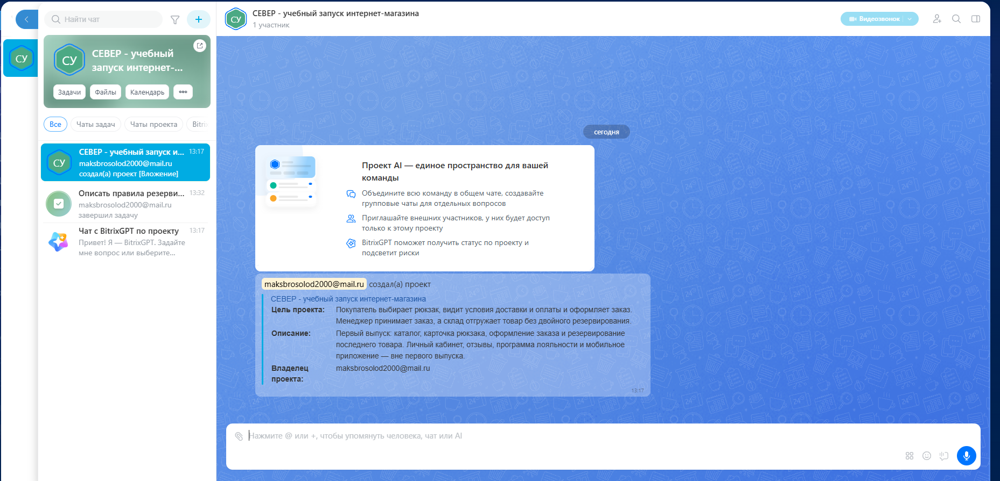
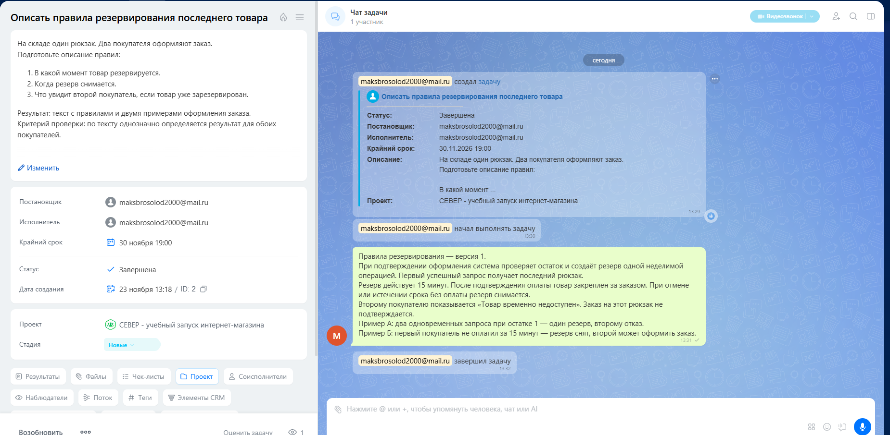
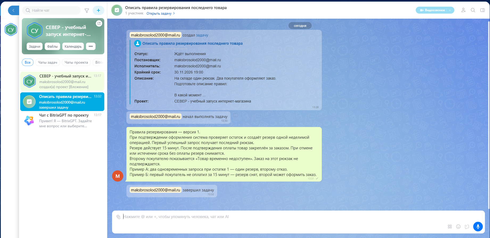
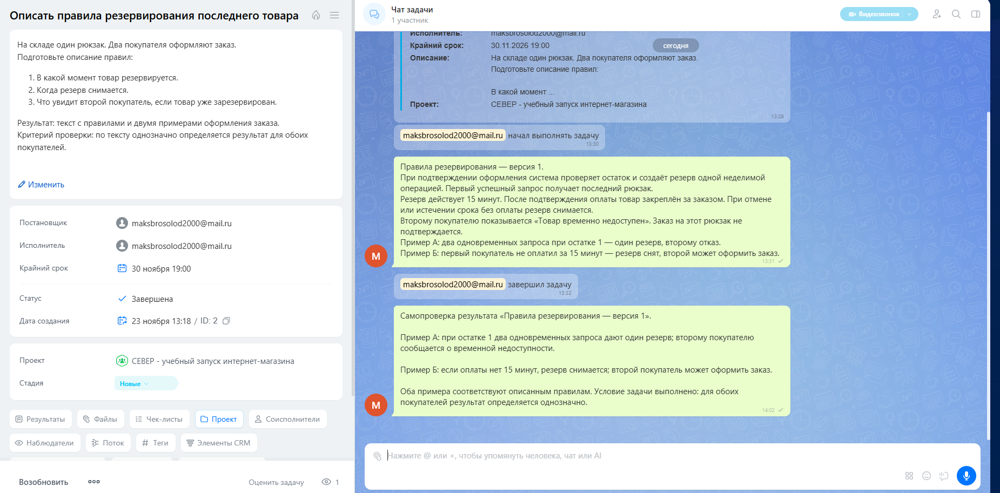
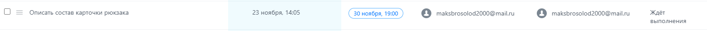
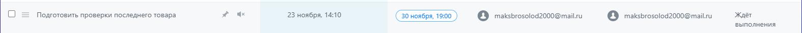

# Отчёт по теме 2. Проект, задача и результат

Замените пять заглушек в полях ниже своими полными ссылками `https://...`. Скриншоты загрузите в `screenshots/` с указанными ниже именами. Ссылки на снимки уже готовы — не удаляйте их.

Репозиторий: https://github.com/yotoros/pr0ject-management

Проект: https://b24-ri9m2f.bitrix24.ru/workgroups/

Задача 1: https://b24-ri9m2f.bitrix24.ru/workgroups/group/2/tasks/task/view/2/

Задача 2: https://b24-ri9m2f.bitrix24.ru/workgroups/group/2/tasks/task/view/4/

Задача 3: https://b24-ri9m2f.bitrix24.ru/workgroups/group/2/tasks/task/view/6/

## Скриншоты

### 1. Проект: название, цель и границы

Что должно быть видно: название проекта, описание и основные сведения.

### 2. Условия первой задачи

Что должно быть видно: название задачи, описание, исполнитель и срок.

### 3. Результат: правила и два примера

Что должно быть видно: правила резервирования и два примера.

### 4. Самопроверка или отзыв

Что должно быть видно: сообщение с самопроверкой результата.

### 5. Завершённая первая задача

Что должно быть видно: статус задачи «Завершена».

### 6. Условия задачи о карточке товара

Что должно быть видно: описание задачи о составе карточки рюкзака.

### 7. Условия задачи о проверках

Что должно быть видно: описание задачи о трёх проверках последнего товара.
